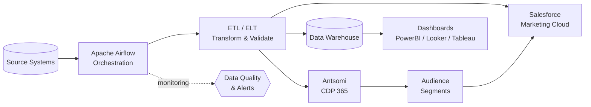

	

<h1 align="center">Hello, I'm Duan Nguyen Duy 👋</h1>

	

	
	
	
	

---

## 🧑‍💻 About Me
I'm a data engineer with hands-on experience in building and maintaining data pipelines, specializing in Apache Airflow orchestration and Salesforce Marketing Cloud integrations. My background includes working with Customer Data Platform (CDP) solutions, particularly Antsomi CDP 365. I'm passionate about exploring data, understanding the issues surrounding it, and leveraging data to derive actionable insights. With practical knowledge in data integration, ETL development, system monitoring, segmentation, and analytics reporting, I help organizations build robust and scalable data infrastructure while unlocking the power of their customer data.

My experience has strengthened my technical skills in data engineering tools, workflow automation, and BI tools while developing my business acumen. I excel at understanding requirements and delivering data solutions that address real business challenges.

Coding is also something I quite enjoy - there's a lot of logic shown when programming something interesting.

## 🔄 Data Flow I Work With

## 💼 Experience

### 🚀 Data Engineer — Merkle Inc Vietnam (A Dentsu Company)
`September 2025 - Present`
* Design and implement data integration pipelines using Apache Airflow for workflow orchestration and automation
* Develop and maintain integrations with Salesforce Marketing Cloud for marketing automation and customer engagement
* Monitor data pipeline health and performance, ensuring data quality and reliability across systems
* Build scalable ETL processes to handle large-scale data processing and transformation
* Collaborate with cross-functional teams to understand data requirements and deliver robust data solutions
* Troubleshoot and resolve data integration issues, maintaining high system availability

### 📊 Data Analyst — Antsomi Vietnam
`October 2024 - September 2025`
* Implemented and optimized Antsomi CDP 365 solutions for multiple clients, resulting in improved customer data management
* Created and managed audience segments based on behavioral and attribute data, enabling targeted marketing campaigns
* Developed custom ETL processes to integrate data from multiple sources into a unified customer view
* Built comprehensive dashboards and analytical reports to track campaign performance metrics
* Collaborated directly with clients to understand business requirements and deliver actionable insights
* Automated routine data tasks using Python, increasing team efficiency by 25%
* Provided technical support and training to clients on CDP 365 platform features and capabilities

## 🎓 Education

**University of Economics and Law, VNU-HCM, Vietnam** `Sep 2021 - May 2025`
 
**Bachelor's Degree in Management Information System**
 
**[Coursera Google Business Intelligence Professional (April 2024 - May 2024)](https://coursera.org/share/b049321d82e58dbc2395ef1b6bdbd2a2)**

## 🛠️ Skills & Tools

### Technical Skills
- Data pipeline development and orchestration
- Apache Airflow workflow automation
- Salesforce Marketing Cloud integration
- ETL/ELT process design and implementation
- Data quality monitoring and validation
- Customer Data Platform (CDP) implementation
- Audience segmentation and analysis
- Campaign analytics and reporting
- Data visualization
- SQL & data querying
- Marketing analytics

### Tools and Technologies

**Data Engineering**

**Program Languages**

-00A1E0?style=flat-square&logo=salesforce&logoColor=white)

**Frameworks / Libraries**

**BI & Analytics Tools**

**Databases**

## 📈 GitHub Stats

	
	

	

	

## 🏆 GitHub Trophy

	

## 🐍 Contribution Snake

	<picture>
		<source media="(prefers-color-scheme: dark)" srcset="https://raw.githubusercontent.com/duan-n2d/duan-n2d/output/github-snake-dark.svg" />
		<source media="(prefers-color-scheme: light)" srcset="https://raw.githubusercontent.com/duan-n2d/duan-n2d/output/github-snake.svg" />
		
	</picture>

## 🤝 Let's Connect
- LinkedIn: [duannguyen2606](https://www.linkedin.com/in/duannguyen2606/)
- Email: [duannguyen2606@gmail.com](mailto:duannguyen2606@gmail.com)
- Portfolio: [duan-n2d](https://duan-n2d.github.io/)

	

