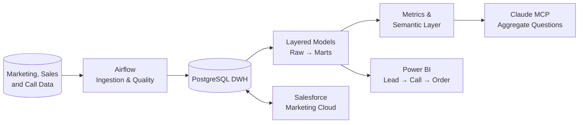

	

<h1 align="center">Hello, I'm Duan Nguyen Duy 👋</h1>

	Ho Chi Minh City

	

	
	
	
	

---

## 🧑‍💻 About Me
Data engineer with 2+ years in analytics engineering and data quality, turning raw marketing, sales, and call-center data into reconciled datasets, data marts, and semantic layers. I defined the Lead → Call → Order funnel for operations and strategy teams, built layered views for 15+ enterprise clients at Antsomi, and created a Claude MCP semantic layer used daily by 10+ people. I combine strong SQL, data quality, and Power BI skills with the engineering depth to run the pipelines behind analytics.

## 🔄 Analytics Data Flow

## 💼 Experience

### 🚀 Junior Data Engineer | Dentsu – Merkle CXM
`September 2025 – Present`
- Defined and delivered the **Lead → Call (contacted) → Order (completed / cancelled) funnel** in Power BI with five-minute refreshes, joined on phone and uid, replacing Excel reporting for operations, agent management, and strategy teams.
- Built a **Claude MCP semantic layer** on the data warehouse after a Hugging Face LLM prototype. Documented tables, columns, types, metrics, and relationships; created one source-of-truth dataset per entity, aggregation tools, per-user session IDs and secret-based access, and a 12-month query limit. Used daily by 10+ people.
- Embedded SQL and Python data-quality checks in Airflow for source-to-target row counts, null and duplicate keys, freshness, and aggregate reconciliation.
- Built and operate **10–20 bidirectional Salesforce Marketing Cloud integrations** with databases, APIs, and SFTP using Airflow, Python, and Automation Studio. Implemented incremental loads by timestamp or ID, duplicate-safe insert/upsert/overwrite, retries, and alerts.
- Sole owner of a **lead-distribution platform** from design through monitoring, serving 8 teams / ~200 agents across ~100 campaigns and processing ~600k leads and ~1M call records monthly. A Next.js app and Python scheduler use agents' last-three-day call performance while balancing distribution, then send real-time ZNS notifications. Replaced manual Excel assignment, reducing hours-long delays, duplicate/missed leads, and staff standby; setup is done once at the start of each month.
- Designed the data flow from a day-partitioned call-center database to a **PostgreSQL DWH**, with Airflow DAGs running every 30 minutes to weekly.
- Enabled campaign users to ask ad-hoc aggregate questions in natural language against raw tables, reducing one-off dashboard requests.
- Run Airflow projects in Docker with GitHub/GitLab version control and GitHub Actions CI/CD.

### 📊 Data Analyst | Antsomi Co., Ltd
`October 2024 – September 2025`
- Built layered views (raw → intermediate → small data marts) for 15+ enterprise clients, including PNJ, AEON Mall, Mega Market, Highland Coffee, and ACFC, turning partitioned source data into analysis-ready datasets across fashion, retail, F&B, e-commerce, and education.
- Reconciled source-to-platform and raw-to-dashboard data; resolved primary-key mismatches by enforcing one profile per phone and labelling secondary numbers.
- Delivered ~10 Power BI report types across fashion, retail, F&B, e-commerce, and education, including sales, journey performance, demographics, RFM, association rules, and site tracking.
- Optimized SQL over 30M+ records per month with partition pruning, column selection, early filtering, pre-aggregation, and CTEs to temp tables, **cutting processing time 2–3×**.
- Integrated 3–5 POS, e-commerce, CRM, and loyalty sources per client through APIs, SFTP, and databases, mapping data to a reusable standard schema.
- Implemented Antsomi CDP 365 solutions and audience segments; clients used RFM clusters to target campaigns and association rules to design product bundles. Automated routine data tasks with Python, increasing team efficiency by 25%, and provided client training and technical support.

### 🧩 Developer Intern | ISONICX Solution Co., Ltd
`October 2022 – December 2023`
- Designed Salesforce data models with SOQL and developed and tested Lightning Web Components (LWC).

## 🛠️ Skills

- **Analytics engineering:** SQL tuning, window functions, CTEs, dimensional and layered modelling, metric definitions, documentation, semantic layers, reconciliation, data quality, Power BI
- **Engineering:** Python, Airflow, PostgreSQL, incremental/idempotent loading, API/SFTP/database integration, Salesforce Marketing Cloud, GitHub/GitLab, Docker, GitHub Actions CI/CD
- **Familiar:** dbt, PySpark, Azure Data Factory, Databricks, Synapse, Microsoft Fabric

## 🚀 Featured Projects

Every number below is measured by the repo's own scripts; each README has an "Honest limits" section.

| Project | What it shows | Stack |
|---|---|---|
| [**Customer Identity Platform**](https://github.com/duan-n2d/customer-identity-platform) | Identity resolution and Customer 360 across POS, e-commerce, CRM and loyalty: stable person IDs, data contracts, GDPR erasure, dbt gold layer, Delta export. 98.8% precision and 99.9–100% day-over-day ID stability on 6,000 synthetic people over 4 daily runs; ablation across 3 seeds | Python, DuckDB, Splink, dbt, Delta Lake, FastAPI, Airflow |
| [**Uplift Targeting Engine**](https://github.com/duan-n2d/uplift-targeting-engine) | Who should get a voucher when only 20% can? S/T/X-learners on Criteo's 14M-row randomised experiment with bootstrap Qini/AUUC and a leakage study. Top 20% yields 4× random's incremental conversions; on conversion it ties a plain response model, and the README says so | LightGBM, MLflow, FastAPI, Streamlit |
| [**OSS Pulse**](https://github.com/duan-n2d/oss-pulse) | How fast do Spark, Airflow, Polars, dbt, DuckDB and 9 other data projects review and merge PRs? dbt-duckdb star schema (SCD2, incremental, contracts) over 38.9k real PRs, pseudonymised contributors, volume-anomaly monitoring, daily Actions → [live dashboard](https://duan-n2d.github.io/oss-pulse/). Newcomers wait 17.7 h for a first response vs 6.2 h for maintainers | dbt, DuckDB, GitHub API, GH Archive, GitHub Actions/Pages |
| [**WorldCup Pulse**](https://github.com/duan-n2d/worldcup-pulse) | $0 serverless lakehouse on real API data (104 matches, 48 teams): medallion ETL, quality checks, a Bronze replay after the source went offline · [live app](https://huggingface.co/spaces/n2d/worldcup-pulse-overview) | GitHub Actions, DuckDB, Hugging Face, Streamlit |
| [**Dylxn Assistant**](https://github.com/duan-n2d/dylxn-assistant) | Local-first RAG over a data-engineering knowledge base, evaluated on a 60-question golden set: hybrid retrieval hit@5 90% vs 78% semantic-only after fixing the keyword path | Python, Qdrant, E5, SQLite FTS5, Ollama, FastAPI |
| [**Analytics Case Studies**](https://github.com/duan-n2d/analytics-case-studies) | BI dashboards, RFM segmentation, SQL marketing engine, and Data Got Talent 2024 submissions | Power BI, SQL, Python |

**Prototypes (designed, not yet run end to end):** [OpenLake Commerce Platform](https://github.com/duan-n2d/openlake-commerce-platform) (Postgres CDC → Kafka → Flink → Iceberg, dbt, Dagster) · [Elite Football DecisionOps](https://github.com/duan-n2d/elite-football-club-decisionops-lakehouse) (governed data products; the runnable core is plain Python) · [Azure End-to-End DE](https://github.com/duan-n2d/Azure-End-to-End-Data-Engineering-Solution) (ADF pipelines; notebooks not included)

**Learning & research:** [AI-Augmented DE Roadmap](https://github.com/duan-n2d/learning-data-platform) · [Modern Data Stack deck](https://duan-n2d.github.io/modern-data-stack/) · [Churn prediction with time-series classification](https://github.com/duan-n2d/Predicting-customers-churn-using-time-series-classification) (paper summary: MINIROCKET, LSTM)

## 🔧 Open-source contributions

| Project | Pull request | Status |
|---|---|---|
| Apache Spark | [Fix `min_periods` for `Rolling.count` to match pandas (SPARK-43432)](https://github.com/apache/spark/pull/60614) | open |
| Apache Airflow | [Reject serde uuid and datetime payloads from a newer version](https://github.com/apache/airflow/pull/77012) | open |
| Polars | [Preserve fractional scalar values in Series ops](https://github.com/pola-rs/polars/pull/30893) | open |
| Apache Arrow JS | [Reject record batches with missing dictionaries](https://github.com/apache/arrow-js/pull/539) | open |
| Fivetran dbt_recurly | [Order `is_most_recent_record` with nulls last so warehouses agree](https://github.com/fivetran/dbt_recurly/pull/57) | open |
| wheelgap/tracker | [Optional python field so a note can retire per Python](https://github.com/wheelgap/tracker/pull/53) | merged |
| Satellite mosaicking pipeline | [State the actual land/sea mask requirements](https://github.com/buckai-observatory/Automated-Cloud-Removal-and-Seamless-Satellite-Image-Mosaicking-Pipeline/pull/57) | merged |

## 🏅 Leadership

- **Software Team Leader, ITB Club (2021–2024):** led two Business Intelligence competitions (Seasons 6 and 7), delivered two data analysis and BI workshops for 5,000+ students, and built Power BI dashboards to track program metrics.
- **Subject Matter Advisor, BI Competition Season 9 (2025):** mentored student teams on methodology, dashboards, and data storytelling.

## 📜 Certifications

<table>
  <tr>
    <td></td>
    <td>Salesforce Data Cloud Consultant</td>
  </tr>
  <tr>
    <td></td>
    <td>Microsoft DP-700 Fabric Data Engineer</td>
  </tr>
  <tr>
    <td></td>
    <td>DP-800 SQL AI Developer</td>
  </tr>
  <tr>
    <td></td>
    <td>Google Cloud Digital Leader</td>
  </tr>
</table>

## 🎓 Education

**B.Sc. Management Information Systems** | University of Economics and Law, VNU-HCM `2021 – 2025`

Prospect Award, Data Got Talent 2023 · Full scholarship, VietSeeds Foundation (2021–2025)
 
[Google Business Intelligence Professional Certificate](https://coursera.org/share/b049321d82e58dbc2395ef1b6bdbd2a2) `April 2024 – May 2024`

## 📈 GitHub Stats

	
	

## 🤝 Let's Connect
- LinkedIn: [duannguyen2606](https://www.linkedin.com/in/duannguyen2606/)
- Email: [duannguyen2606@gmail.com](mailto:duannguyen2606@gmail.com)
- GitHub: [duan-n2d](https://github.com/duan-n2d)

	

