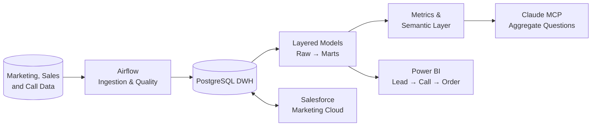

	

<h1 align="center">Hello, I'm Duan Nguyen Duy 👋</h1>

	Ho Chi Minh City

	

	
	
	
	

---

## 🧑‍💻 About Me
Analytics Engineer with 2+ years turning raw marketing, sales, and call-center data into reconciled datasets, data marts, and semantic layers. I defined the Lead → Call → Order funnel for operations and strategy teams, built layered views for 15+ enterprise clients at Antsomi, and created a Claude MCP semantic layer used daily by 10+ people. I combine strong SQL, data quality, and Power BI skills with the engineering depth to run the pipelines behind analytics.

## 🔄 Analytics Data Flow

## 💼 Experience

### 🚀 Junior Data Engineer | Dentsu – Merkle CXM
`September 2025 – Present`
- Defined and delivered the **Lead → Call (contacted) → Order (completed / cancelled) funnel** in Power BI with five-minute refreshes, joined on phone and uid, replacing Excel reporting for operations, agent management, and strategy teams.
- Built a **Claude MCP semantic layer** on the data warehouse after a Hugging Face LLM prototype. Documented tables, columns, types, metrics, and relationships; created one source-of-truth dataset per entity, aggregation tools, per-user session IDs and secret-based access, and a 12-month query limit. Used daily by 10+ people.
- Embedded SQL and Python data-quality checks in Airflow for source-to-target row counts, null and duplicate keys, freshness, and aggregate reconciliation.
- Built and operate **10–20 bidirectional Salesforce Marketing Cloud integrations** with databases, APIs, and SFTP using Airflow, Python, and Automation Studio. Implemented incremental loads by timestamp or ID, duplicate-safe insert/upsert/overwrite, retries, and alerts.
- Sole owner of a **lead-distribution platform** from design through monitoring, serving 8 teams / ~200 agents across ~100 campaigns and processing ~600k leads and ~1M call records monthly. A Next.js app and Python scheduler use agents' last-three-day call performance while balancing distribution, then send real-time ZNS notifications. Replaced manual Excel assignment, reducing hours-long delays, duplicate/missed leads, and staff standby; setup is done once at the start of each month.
- Designed the data flow from a day-partitioned call-center database to a **PostgreSQL DWH**, with Airflow DAGs running every 30 minutes to weekly.
- Enabled campaign users to ask ad-hoc aggregate questions in natural language against raw tables, reducing one-off dashboard requests.
- Run Airflow projects in Docker with GitHub/GitLab version control and GitHub Actions CI/CD.

### 📊 Data Analyst | Antsomi Co., Ltd
`October 2024 – September 2025`
- Built layered views (raw → intermediate → small data marts) for 15+ enterprise clients, including PNJ, AEON Mall, Mega Market, Highland Coffee, and ACFC, turning partitioned source data into analysis-ready datasets across fashion, retail, F&B, e-commerce, and education.
- Reconciled source-to-platform and raw-to-dashboard data; resolved primary-key mismatches by enforcing one profile per phone and labelling secondary numbers.
- Delivered ~10 Power BI report types across fashion, retail, F&B, e-commerce, and education, including sales, journey performance, demographics, RFM, association rules, and site tracking.
- Optimized SQL over 30M+ records per month with partition pruning, column selection, early filtering, pre-aggregation, and CTEs to temp tables, **cutting processing time 2–3×**.
- Integrated 3–5 POS, e-commerce, CRM, and loyalty sources per client through APIs, SFTP, and databases, mapping data to a reusable standard schema.
- Implemented Antsomi CDP 365 solutions and audience segments; clients used RFM clusters to target campaigns and association rules to design product bundles. Automated routine data tasks with Python, increasing team efficiency by 25%, and provided client training and technical support.

### 🧩 Developer Intern | ISONICX Solution Co., Ltd
`October 2022 – December 2023`
- Designed Salesforce data models with SOQL and developed and tested Lightning Web Components (LWC).

## 🛠️ Skills

- **Analytics engineering:** SQL tuning, window functions, CTEs, dimensional and layered modelling, metric definitions, documentation, semantic layers, reconciliation, data quality, Power BI
- **Engineering:** Python, Airflow, PostgreSQL, incremental/idempotent loading, API/SFTP/database integration, Salesforce Marketing Cloud, GitHub/GitLab, Docker, GitHub Actions CI/CD
- **Familiar:** dbt, PySpark, Azure Data Factory, Databricks, Synapse, Microsoft Fabric

## 🚀 Featured Projects

| Project | What it shows | Stack |
|---|---|---|
| [**OpenLake Commerce Platform**](https://github.com/duan-n2d/openlake-commerce-platform) | Open-source streaming lakehouse: Postgres CDC → Kafka → Flink → Iceberg, dbt marts, quality gates, lineage, BI and API | Debezium, Kafka, Flink, Iceberg, Trino, dbt, Dagster, Great Expectations |
| [**Elite Football DecisionOps Lakehouse**](https://github.com/duan-n2d/elite-football-club-decisionops-lakehouse) | Stakeholder-driven lakehouse with governed Gold data products, API, dashboard, and an AI copilot with SQL guardrails | Python, Spark/Delta, FastAPI, Streamlit, Databricks, Terraform |
| [**WorldCup Pulse**](https://github.com/duan-n2d/worldcup-pulse) | $0 serverless near-real-time pipeline: incremental medallion ETL, HF Dataset storage, BI and DataOps apps | GitHub Actions, Cloudflare Workers, DuckDB, Streamlit |
| [**Dylxn Assistant**](https://github.com/duan-n2d/dylxn-assistant) | Local-first RAG assistant over a Markdown data-engineering knowledge base | Python, Qdrant, E5 embeddings, Ollama, FastAPI |
| [**Azure End-to-End DE**](https://github.com/duan-n2d/Azure-End-to-End-Data-Engineering-Solution) | On-prem SQL Server → ADLS medallion lakehouse → Synapse → Power BI | ADF, Databricks, Delta Lake, Synapse, Key Vault |
| [**Analytics Case Studies**](https://github.com/duan-n2d/analytics-case-studies) | BI dashboards, RFM segmentation, ML experiments, and Data Got Talent 2024 submissions | Power BI, SQL, Python |

**Learning & research:** [AI-Augmented DE Roadmap](https://github.com/duan-n2d/learning-data-platform) · [Modern Data Stack deck](https://duan-n2d.github.io/modern-data-stack/) · [Churn prediction with time-series classification](https://github.com/duan-n2d/Predicting-customers-churn-using-time-series-classification) (MINIROCKET, LSTM — 95% accuracy, F1 79%)

## 🏅 Leadership

- **Software Team Leader, ITB Club (2021–2024):** led two Business Intelligence competitions (Seasons 6 and 7), delivered two data analysis and BI workshops for 5,000+ students, and built Power BI dashboards to track program metrics.
- **Subject Matter Advisor, BI Competition Season 9 (2025):** mentored student teams on methodology, dashboards, and data storytelling.

## 📜 Certifications

Microsoft DP-700 Fabric Data Engineer · DP-800 SQL AI Developer · Salesforce Data Cloud Consultant · Google Cloud Digital Leader

## 🎓 Education

**B.Sc. Management Information Systems** | University of Economics and Law, VNU-HCM `2021 – 2025`

Prospect Award, Data Got Talent 2023 · Full scholarship, VietSeeds Foundation (2021–2025)
 
[Google Business Intelligence Professional Certificate](https://coursera.org/share/b049321d82e58dbc2395ef1b6bdbd2a2) `April 2024 – May 2024`

## 📈 GitHub Stats

	
	

	

	

## 🏆 GitHub Trophy

	

## 🐍 Contribution Snake

	<picture>
		<source media="(prefers-color-scheme: dark)" srcset="https://raw.githubusercontent.com/duan-n2d/duan-n2d/output/github-snake-dark.svg" />
		<source media="(prefers-color-scheme: light)" srcset="https://raw.githubusercontent.com/duan-n2d/duan-n2d/output/github-snake.svg" />
		
	</picture>

## 🤝 Let's Connect
- LinkedIn: [duannguyen2606](https://www.linkedin.com/in/duannguyen2606/)
- Email: [duannguyen2606@gmail.com](mailto:duannguyen2606@gmail.com)
- Portfolio: [duan-n2d](https://duan-n2d.github.io/)

	

